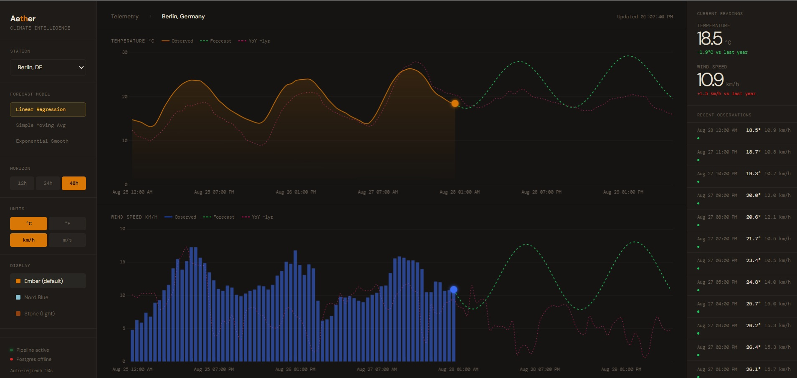
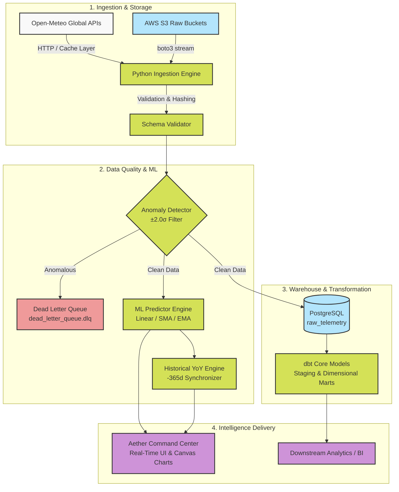

# Aether — Climate Intelligence & Telemetry Analytics Engine

[](https://github.com/your-org/aether/actions)
[](https://www.python.org/downloads/)
[](https://www.postgresql.org/)
[](https://github.com/psf/black)
[](https://www.getdbt.com/)
[](https://airflow.apache.org/)
[](https://www.terraform.io/)
[](https://opensource.org/licenses/MIT)

**Aether** is an enterprise-grade, end-to-end meteorological and climate telemetry analytics platform. It ingests high-frequency atmospheric data across global stations, applies automated statistical anomaly detection, runs multi-model machine learning forecasting engines, and delivers real-time Year-over-Year (YoY) comparative analytics through a custom field-station command dashboard.

<div align="center">
  
</div>

**Live dashboard:** [miladgk.github.io/aether-climate-engine](https://miladgk.github.io/aether-climate-engine/)

---

## 🌟 Key Features

- **🌐 Multi-Station Global Ingestion**: Real-time atmospheric data ingestion pipeline supporting global monitoring stations (Berlin, Tokyo, New York, London, Sydney, etc.) via Open-Meteo & AWS S3.
- **🔍 Statistical Anomaly Detection**: Real-time $\pm 2.0\sigma$ Z-score anomaly filtering with automated Dead Letter Queue (`.dlq`) isolation and routing.
- **🤖 Multi-Model Machine Learning Engine**:
  - **Linear Regression**: Diurnal harmonic trend forecasting with graceful pure-Python fallback.
  - **Simple Moving Average (SMA)**: Rolling window baseline trend smoothing.
  - **Exponential Moving Average (EMA)**: Exponential decay memory modeling for high-responsiveness.
- **📈 Full-Timeline YoY Comparative Analytics**: Aligns 365-day historical baselines against live and forecasted horizons for climate variance insights.
- **🎛️ Field Research Station Dashboard**:
  - Live animated telemetry plotting with Chart.js.
  - Dynamic unit conversion on the fly ($^\circ\text{C} \leftrightarrow ^\circ\text{F}$, $\text{km/h} \leftrightarrow \text{m/s}$) with auto-scaling delta thresholds.
  - Interactive multi-theme engine (*Dark Station*, *Nord Frost*, *Stone Paper*).
  - Real-time blinking radar indicators marking the exact current-time horizon.
- **🏗️ Modern Data Warehouse & Modeling**: PostgreSQL raw layer paired with **dbt Core** dimensional models (staging, marts, facts) and **Apache Airflow** orchestration.
- **☁️ Infrastructure as Code (IaC)**: Modular **Terraform** configurations for AWS S3, IAM policies, and cloud storage lifecycle management.
- **🧪 Robust Testing & Security**: Unit, smoke, integration (real PostgreSQL), E2E + cross-browser compatibility (Chromium/Firefox/WebKit via Playwright) and regression test layers via Pytest (`pytest-mock`, `moto`), Bandit SAST scanning, `pip-audit` dependency/CVE scanning, and a GitHub Actions CI workflow that runs them all on every push/PR.

---

## 🏛️ System Architecture



---

## 📁 Repository Structure

```
.
├── config.json                 # Station coordinates, ML horizons & pipeline configuration
├── dags/                       # Apache Airflow workflow DAG definitions
│   └── telemetry_pipeline.py   # Airflow daily ingestion & transformation DAG
├── dashboard/                  # Aether Command Center Web Interface
│   ├── index.html              # Custom Field Station interface & Chart.js engine
│   ├── sample_telemetry.json   # Live & Historical station telemetry cache
│   └── predictions.json        # Precomputed multi-model ML forecast output
├── dbt_telemetry/              # dbt Core dimensional models & staging SQL
│   ├── dbt_project.yml
│   └── models/
│       ├── staging/            # Data cleansing & column casting
│       └── marts/              # Fact & dimension aggregate tables
├── docs/                       # Architectural documentation & Data Dictionary
│   ├── data_dictionary.md      # Schema definitions & metric types
│   └── runbook.md              # Operational runbook & troubleshooting
├── scripts/                    # Utility scripts & dashboard server
│   ├── serve_dashboard.py      # Lightweight local telemetry server
│   └── custom_bandit.py        # Static security analyzer script
├── src/                        # Core Python package
│   ├── etl/
│   │   ├── anomaly_detector.py # Statistical variance & anomaly filtering
│   │   ├── cache_manager.py    # Local filesystem TTL caching
│   │   ├── extract_load.py     # Main ingestion orchestrator
│   │   ├── utils.py            # PII hashing & JSON flattening
│   │   └── validator.py        # Schema validation
│   ├── infrastructure/
│   │   └── postgres_connector.py # SQLAlchemy / Psycopg2 connection pooler
│   └── ml/
│       └── predictor.py        # Linear, SMA, and EMA forecasting models
├── terraform/                  # Infrastructure as Code
│   ├── main.tf                 # S3 buckets & AWS IAM policies
│   └── variables.tf
└── tests/                      # Automated test suite (unit, smoke, integration)
    ├── conftest.py             # Mock fixtures (AWS, Postgres)
    ├── test_extract_load.py    # Unit: ETL logic
    ├── test_predictor.py       # Unit: ML forecasting models
    ├── test_pii.py             # Unit: PII hashing
    ├── test_smoke.py           # Smoke: fast end-to-end sanity pass
    ├── test_integration_postgres.py  # Integration: real PostgreSQL round-trip
    └── test_e2e_dashboard.py   # E2E + Compatibility: live dashboard across 3 browser engines
```

---

## 🚀 Quickstart Guide

### 1. Prerequisites
- Python 3.10+
- (Optional) Docker & Docker Compose (for PostgreSQL)

### 2. Clone and Setup Environment
```bash
git clone https://github.com/your-username/aether.git
cd aether

# Create and activate virtual environment
python3 -m venv venv
source venv/bin/activate

# Install dependencies
pip install -r requirements.txt
```

### 3. Environment Configuration
```bash
cp .env.example .env
# Edit .env with your PostgreSQL credentials if running locally
```

### 4. Run the ETL & Machine Learning Pipeline
Execute the ingestion script to fetch real-time station metrics, run anomaly detection, and compute multi-model forecasts:
```bash
PYTHONPATH=. python3 src/etl/extract_load.py
```

### 5. Launch the Command Center Dashboard
Start the local dashboard server:
```bash
python3 scripts/serve_dashboard.py
```
Open **[http://localhost:8000](http://localhost:8000)** in your browser.

---

## 🧪 Testing & Quality Assurance

This project exercises several layers of the testing pyramid, each catching a different class of bug:

| Layer | Files | What it catches |
|---|---|---|
| **Unit** | `test_extract_load.py`, `test_predictor.py`, `test_pii.py` | Logic bugs in a single function (flattening, anomaly math, PII hashing), fully mocked — no network, no DB. |
| **Smoke** | `test_smoke.py` | Fast, shallow sanity pass over the whole build: do core modules import, is `config.json` valid, do the ETL/ML stages run end-to-end on a tiny dataset? |
| **Integration** | `test_integration_postgres.py` | `PostgresClient` against a **real** PostgreSQL instance (table creation, bulk insert via `execute_values`, round-tripped reads) — the SQL path that mocks can't verify. Auto-skips if no database is reachable. |
| **E2E** | `test_e2e_dashboard.py` | Drives the actual dashboard with Playwright: page loads, Chart.js renders both charts, unit/theme toggles update the UI, station switching updates the topbar — the only layer that touches the frontend JS at all. |
| **Compatibility** | `test_e2e_dashboard.py` (parametrized) | Every E2E test above runs once per rendering engine — **Chromium, Firefox, WebKit/Safari** — so a browser-specific CSS/JS quirk fails on that one engine instead of going unnoticed. Any engine not installed is skipped individually. |
| **Regression** | the full suite, run in CI on every push/PR | Re-runs everything above automatically so a change can't silently break a previously-working feature. |
| **Security (SAST)** | `scripts/custom_bandit.py` | Static scan for insecure patterns in *our own code* (hardcoded secrets, unsafe deserialization, etc.). |
| **Dependency / SCA Scanning** | `pip-audit` (CI step) | Scans every *third-party* package actually installed (`apache-airflow`, `protobuf`, `pytest`, etc.) against the PyPA Advisory Database for known CVEs — catches vulnerable dependencies that SAST never looks at. Advisory only: reports findings in the CI log without failing the build, since upgrading a pinned framework version (e.g. Airflow) is a deliberate decision, not something a gate should force on every push. |

Run everything:
```bash
# Full suite (unit + smoke + integration where a DB is reachable + E2E where a browser is installed)
pytest tests/ -v

# Just the integration tests, against a local Postgres container:
docker run -d -p 5432:5432 \
  -e POSTGRES_USER=aether_user -e POSTGRES_PASSWORD=aether_password \
  -e POSTGRES_DB=aether_warehouse postgres:15
pytest tests/test_integration_postgres.py -v

# Just the E2E + cross-browser compatibility tests (one-time browser install, then run):
playwright install chromium firefox webkit
pytest tests/test_e2e_dashboard.py -v

# Run security static analysis (our own code)
python3 scripts/custom_bandit.py

# Scan third-party dependencies for known CVEs
pip install pip-audit
pip-audit
```

The CI workflow (`.github/workflows/ci.yml`) spins up a real Postgres service container, so the integration tests run on every push/PR, not just locally.

### Dependency remediation (what `pip-audit` found and what we did about it)

Running the scan surfaced a real, pre-existing dependency conflict and a set of outdated/vulnerable pins. Here's what was fixed and what's structurally blocked:

**Fixed:**
- Removed an explicit `protobuf<4.25.0` pin that conflicted with `apache-airflow`'s own `opentelemetry-proto` requirement (`protobuf>=5.0`) — this was breaking `pip install -r requirements.txt` entirely on a clean environment. Letting pip's resolver pick the version itself (`protobuf==5.29.6`) resolves it.
- `apache-airflow` `2.8.1` → `2.10.5` (latest 2.x release) — removes every CVE that had a 2.x fix, without the breaking API migration to Airflow 3.x. Updated `dags/daily_telemetry_ingestion.py` to drop two now-deprecated APIs (`schedule_interval` → `schedule`, removed `provide_context=True`) surfaced by the upgrade.
- `pytest` `8.0.0` → `9.0.3` — verified against the full suite (30 tests, including E2E across 3 browsers and the Postgres integration tests) on Python 3.10, matching CI exactly.
- `pip`/`setuptools` are now upgraded explicitly in the CI install step.

**Structurally blocked (verified by actually attempting each, not guessed):**
- `apache-airflow` and its provider packages still carry CVEs whose only fix is Airflow **3.x** — a breaking architecture change, out of scope for an in-place dependency bump.
- `cryptography`, `urllib3`, `sqlparse` can't be upgraded past their vulnerable versions because `dbt-core==1.7.0` hard-pins `cffi<2.0.0` and `urllib3~=1.0`; every patched release of those libraries requires newer versions than that. Unblocking this needs a `dbt-core` 1.8+ upgrade (a package-split architecture change in dbt itself) that hasn't been validated against this project's `dbt_telemetry/` models.
- `flask`, `werkzeug`, `flask-appbuilder` are version-capped by Airflow 2.x's own webserver compatibility requirements, not by anything in this project.
- `dnspython`, `filelock` only ship CVE fixes in releases that require **Python 3.11+**, while CI runs Python 3.10.

The dependency scan step stays advisory (reports, doesn't fail the build) so these known, upstream-blocked findings don't turn CI red on every push.

---

## 📊 dbt Dimensional Modeling

To compile and execute the dbt transformation models:
```bash
cd dbt_telemetry
dbt deps
dbt run
dbt test
dbt docs generate && dbt docs serve
```

---

## 📄 License

This project is licensed under the MIT License — see the [LICENSE](LICENSE) file for details.
