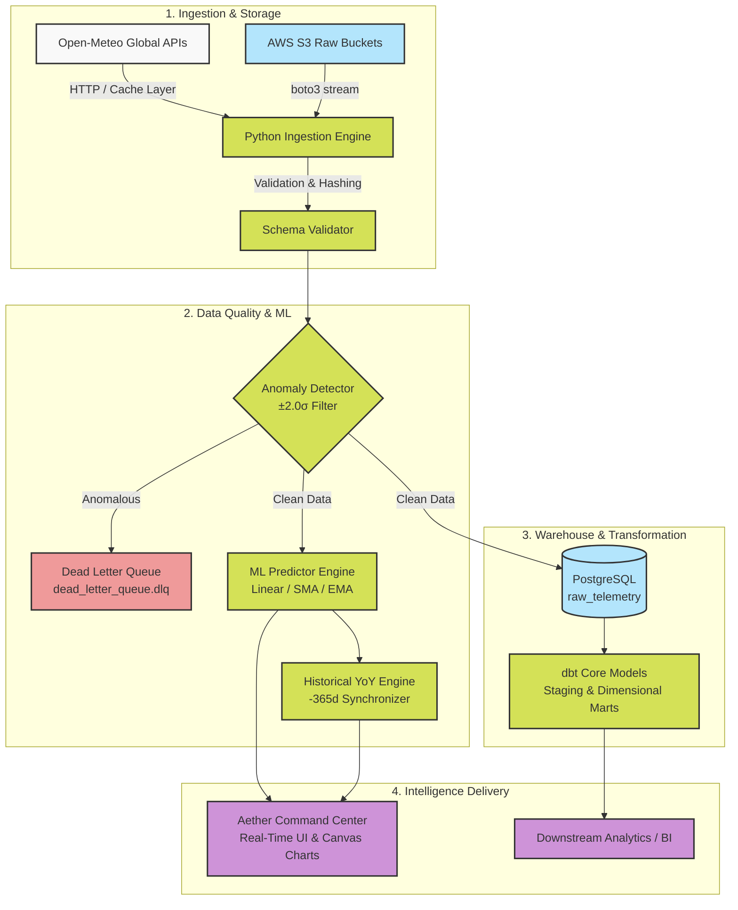

# Aether — Climate Intelligence & Telemetry Analytics Engine

[](https://github.com/your-org/aether/actions)
[](https://www.python.org/downloads/)
[](https://www.postgresql.org/)
[](https://github.com/psf/black)
[](https://www.getdbt.com/)
[](https://airflow.apache.org/)
[](https://www.terraform.io/)
[](https://opensource.org/licenses/MIT)

**Aether** is an enterprise-grade, end-to-end meteorological and climate telemetry analytics platform. It ingests high-frequency atmospheric data across global stations, applies automated statistical anomaly detection, runs multi-model machine learning forecasting engines, and delivers real-time Year-over-Year (YoY) comparative analytics through a custom field-station command dashboard.

<div align="center">
  
</div>

---

## 🌟 Key Features

- **🌐 Multi-Station Global Ingestion**: Real-time atmospheric data ingestion pipeline supporting global monitoring stations (Berlin, Tokyo, New York, London, Sydney, etc.) via Open-Meteo & AWS S3.
- **🔍 Statistical Anomaly Detection**: Real-time $\pm 2.0\sigma$ Z-score anomaly filtering with automated Dead Letter Queue (`.dlq`) isolation and routing.
- **🤖 Multi-Model Machine Learning Engine**:
  - **Linear Regression**: Diurnal harmonic trend forecasting with graceful pure-Python fallback.
  - **Simple Moving Average (SMA)**: Rolling window baseline trend smoothing.
  - **Exponential Moving Average (EMA)**: Exponential decay memory modeling for high-responsiveness.
- **📈 Full-Timeline YoY Comparative Analytics**: Aligns 365-day historical baselines against live and forecasted horizons for climate variance insights.
- **🎛️ Field Research Station Dashboard**:
  - Live animated telemetry plotting with Chart.js.
  - Dynamic unit conversion on the fly ($^\circ\text{C} \leftrightarrow ^\circ\text{F}$, $\text{km/h} \leftrightarrow \text{m/s}$) with auto-scaling delta thresholds.
  - Interactive multi-theme engine (*Dark Station*, *Nord Frost*, *Stone Paper*).
  - Real-time blinking radar indicators marking the exact current-time horizon.
- **🏗️ Modern Data Warehouse & Modeling**: PostgreSQL raw layer paired with **dbt Core** dimensional models (staging, marts, facts) and **Apache Airflow** orchestration.
- **☁️ Infrastructure as Code (IaC)**: Modular **Terraform** configurations for AWS S3, IAM policies, and cloud storage lifecycle management.
- **🧪 Robust Testing & Security**: Pytest suite with mock layers (`pytest-mock`, `moto`), Bandit AST security scanning, and GitHub Actions CI workflow.

---

## 🏛️ System Architecture



---

## 📁 Repository Structure

```
.
├── config.json                 # Station coordinates, ML horizons & pipeline configuration
├── dags/                       # Apache Airflow workflow DAG definitions
│   └── telemetry_pipeline.py   # Airflow daily ingestion & transformation DAG
├── dashboard/                  # Aether Command Center Web Interface
│   ├── index.html              # Custom Field Station interface & Chart.js engine
│   ├── sample_telemetry.json   # Live & Historical station telemetry cache
│   └── predictions.json        # Precomputed multi-model ML forecast output
├── dbt_telemetry/              # dbt Core dimensional models & staging SQL
│   ├── dbt_project.yml
│   └── models/
│       ├── staging/            # Data cleansing & column casting
│       └── marts/              # Fact & dimension aggregate tables
├── docs/                       # Architectural documentation & Data Dictionary
│   ├── data_dictionary.md      # Schema definitions & metric types
│   └── runbook.md              # Operational runbook & troubleshooting
├── scripts/                    # Utility scripts & dashboard server
│   ├── serve_dashboard.py      # Lightweight local telemetry server
│   └── custom_bandit.py        # Static security analyzer script
├── src/                        # Core Python package
│   ├── etl/
│   │   ├── anomaly_detector.py # Statistical variance & anomaly filtering
│   │   ├── cache_manager.py    # Local filesystem TTL caching
│   │   ├── extract_load.py     # Main ingestion orchestrator
│   │   ├── utils.py            # PII hashing & JSON flattening
│   │   └── validator.py        # Schema validation
│   ├── infrastructure/
│   │   └── postgres_connector.py # SQLAlchemy / Psycopg2 connection pooler
│   └── ml/
│       └── predictor.py        # Linear, SMA, and EMA forecasting models
├── terraform/                  # Infrastructure as Code
│   ├── main.tf                 # S3 buckets & AWS IAM policies
│   └── variables.tf
└── tests/                      # Automated unit test suite
    ├── conftest.py             # Mock fixtures (AWS, Postgres)
    ├── test_anomaly_detector.py
    ├── test_extract_load.py
    └── test_predictor.py
```

---

## 🚀 Quickstart Guide

### 1. Prerequisites
- Python 3.10+
- (Optional) Docker & Docker Compose (for PostgreSQL)

### 2. Clone and Setup Environment
```bash
git clone https://github.com/your-username/aether.git
cd aether

# Create and activate virtual environment
python3 -m venv venv
source venv/bin/activate

# Install dependencies
pip install -r requirements.txt
```

### 3. Environment Configuration
```bash
cp .env.example .env
# Edit .env with your PostgreSQL credentials if running locally
```

### 4. Run the ETL & Machine Learning Pipeline
Execute the ingestion script to fetch real-time station metrics, run anomaly detection, and compute multi-model forecasts:
```bash
PYTHONPATH=. python3 src/etl/extract_load.py
```

### 5. Launch the Command Center Dashboard
Start the local dashboard server:
```bash
python3 scripts/serve_dashboard.py
```
Open **[http://localhost:8000](http://localhost:8000)** in your browser.

---

## 🧪 Testing & Quality Assurance

Run the comprehensive unit test suite:
```bash
# Run pytest with coverage
pytest tests/ -v

# Run security static analysis
python3 scripts/custom_bandit.py
```

---

## 📊 dbt Dimensional Modeling

To compile and execute the dbt transformation models:
```bash
cd dbt_telemetry
dbt deps
dbt run
dbt test
dbt docs generate && dbt docs serve
```

---

## 📄 License

This project is licensed under the MIT License — see the [LICENSE](LICENSE) file for details.
