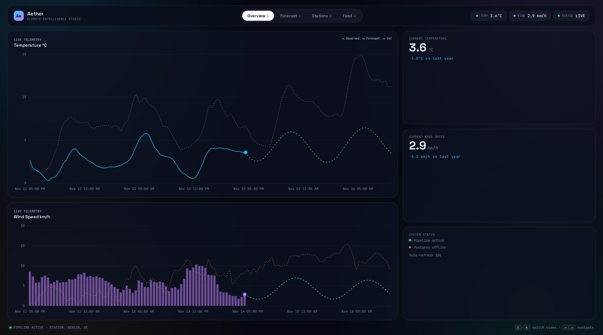
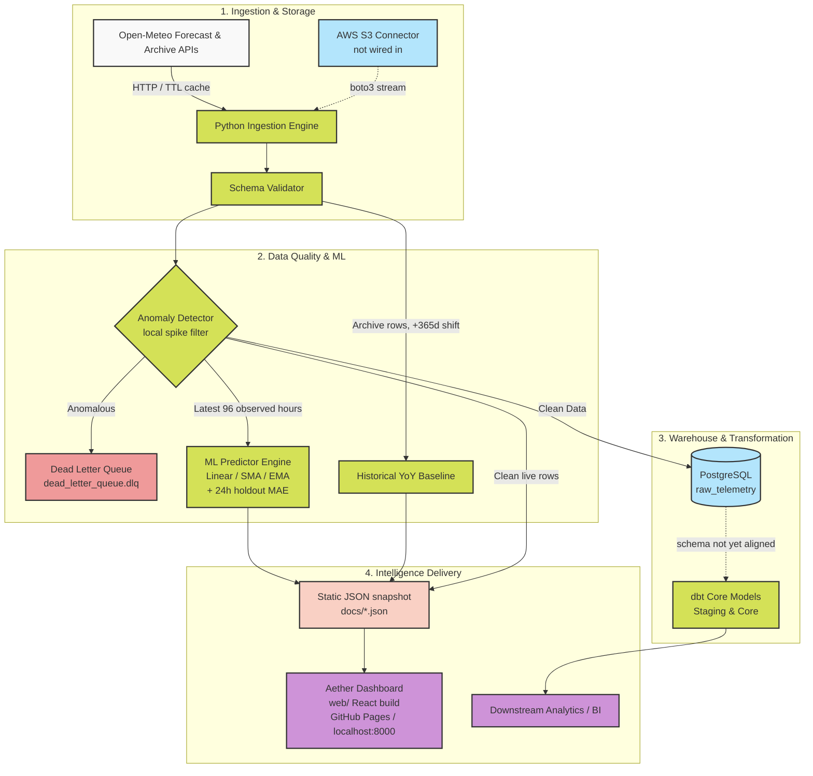

# Aether — Climate Intelligence & Telemetry Analytics Engine

[](https://github.com/miladgk/aether-climate-engine/actions)
[](https://www.python.org/downloads/)
[](https://www.postgresql.org/)
[](https://github.com/psf/black)
[](https://www.getdbt.com/)
[](https://airflow.apache.org/)
[](https://www.terraform.io/)
[](https://opensource.org/licenses/MIT)

**Aether** is an end-to-end weather-telemetry pipeline and dashboard. It pulls hourly temperature and wind data for six cities (Berlin, Tokyo, New York, London, Sydney, and Helsinki) from the Open-Meteo APIs, validates it, filters statistical outliers into a dead-letter queue, produces 48-hour forecasts with three models, and compares everything against the same hours one year earlier in a static React + Chart.js dashboard (`web/`) published on GitHub Pages.

<div align="center">
  
</div>

**Live dashboard:** [miladgk.github.io/aether-climate-engine](https://miladgk.github.io/aether-climate-engine/)

---

## 🌟 Key Features

- **🌐 Multi-Station Global Ingestion & Two-Speed Architecture**: Automated dual-pipeline architecture: hourly lightweight live telemetry ingestion (`pages.yml` at minute 17) for real-time readings without git churn, coupled with a daily deep analytical & ML warehouse pipeline (`scheduled_ingestion.yml` at 05:17 UTC) supporting 6 global monitoring stations (Berlin, Tokyo, New York, London, Sydney, Helsinki) via the Open-Meteo APIs, with an exponential-backoff retry mechanism and a local TTL response cache. An AWS S3 streaming connector is provided in `src/infrastructure/s3_connector.py` as cloud reference architecture.
- **🔍 Statistical Anomaly Detection**: A local spike filter on live temperature and wind (per station): each hour is compared with a robust line fitted through the 3 hours on either side, and flagged only if it is more than 2.0 robust σ *and* more than 2.5 °C (temperature) or 12 km/h (wind) off. Normal daily peaks and gradual weather changes pass; sudden jumps are routed, with schema failures, to a Dead Letter Queue (`dead_letter_queue.dlq`).
- **🤖 Multi-Model Machine Learning Engine**:
  - **Linear Regression**: Diurnal harmonic trend forecasting with graceful pure-Python fallback.
  - **Simple Moving Average (SMA)**: Rolling window baseline trend smoothing.
  - **Exponential Moving Average (EMA)**: Exponential decay memory modeling for high-responsiveness.
- **📈 Full-Timeline YoY Comparative Analytics**: Pulls the same calendar window from one year earlier (Open-Meteo archive API), shifts it forward 365 days, and overlays it on the live and forecast curves.
- **🎛️ Field Research Station Dashboard** (React + Vite + Chart.js, in `web/`):
  - Animated Chart.js plots of observed, forecast and last-year data (from a static snapshot, see **Known Limitations**), with local-night shading and reference lines (0 °C / 32 °F freeze, last-year mean, 20 km/h · Beaufort 4).
  - All data timestamps (chart axes, tooltips, observation tape, last observation, CSV export, snapshot time) are shown in **Central European Time** (CET/CEST), converted from each station's local time with its UTC offset. Nothing is shifted to "now". Night shading on the charts still marks night *at the station* (19:00–05:59 local).
  - A header badge that says how old the data is: `generated_at_utc` from `docs/station_summary.json` with its age (e.g. "Data as of Nov 18, 17:02 CET · 29h ago"). It turns amber after 26 h and red after 72 h.
  - Station cards with a 48 h temperature sparkline and a live clock: the station's current local time (CET, JST, EST, GMT, AEDT) with a ☀/☾ marker for whether it is day or night there right now.
  - Per-station provenance: last real observation (`observed_until`), observed-window size (`observed_hours`), IANA time zone, and coordinates with elevation (Open-Meteo's grid cell when the pipeline recorded it, otherwise `config.json` plus a fixed elevation).
  - Dynamic unit conversion on the fly ($^\circ\text{C} \leftrightarrow ^\circ\text{F}$, $\text{km/h} \leftrightarrow \text{m/s}$) with auto-scaling delta thresholds.
  - Interactive multi-theme engine (*Ember*, *Nord*, *Stone*).
  - A "NOW" meridian (dashed line, label, and pulsing beacon) marking the boundary between observed data and the forecast.
  - Per-station YoY anomaly badges, with the biggest warming outlier glowing red and the biggest cooling outlier glowing blue.
  - A "Compare All" ensemble view (default) that shades the min/max band across the three models, and a badge that stars the model with the lowest holdout MAE for the selected station. The MAE is computed by the pipeline (each model forecasts the last 24 observed hours from the hours before them) and published in `docs/station_summary.json`.
  - A holdout MAE breakdown (click the "★ Best in …" badge) comparing all three models, with the number of scored hours (`n`), and a model-spread readout (half the gap between the highest and lowest model at the end of the horizon).
  - An observation tape (last 15 hours) that tags each hour as normal / elevated / severe / freezing with the reason, plus a CSV export of the whole chart window (each row stamped with `snapshot_generated_utc`).
  - Shareable URLs (`?station=…&model=…&horizon=…&temp=…&wind=…&theme=…`) and keyboard shortcuts (press `?`).
  - 12h / 24h / 48h forecast horizon switching. The chart always shows twice as many observed hours as forecast hours (96 + 48, 48 + 24, 24 + 12), on a real hourly time axis in the station's local time.
- **🏗️ Data Warehouse & Orchestration**: Clean readings are batch-loaded into a PostgreSQL `raw_telemetry` table (with graceful fallback when the DB is down), and an **Apache Airflow** DAG wraps the daily ingestion. The **dbt Core** project provides dimensional warehouse transformation models (`stg_weather_telemetry` and `fct_daily_station_metrics`) for analytics and reporting.
- **☁️ Infrastructure as Code (IaC)**: **Terraform** configurations for an AWS S3 bucket (with a 30-day Glacier lifecycle rule) and an RDS PostgreSQL 15 instance. Not provisioned against a live AWS account; the DB password has no default and must be supplied via `TF_VAR_db_password`.
- **🧪 Robust Testing & Security**: Unit, smoke, integration (real PostgreSQL), E2E + cross-browser compatibility (Chromium/Firefox/WebKit via Playwright) and regression test layers via Pytest (`pytest-mock`, `moto`), a custom AST security scan (`scripts/custom_bandit.py`; Bandit itself runs as a pre-commit hook), `pip-audit` dependency/CVE scanning, and a GitHub Actions CI workflow that runs them all on every push/PR.

---

## 🏛️ System Architecture



---

## 📁 Repository Structure

```
.
├── .github/workflows/          # ci.yml (tests, scans, dbt checks) & pages.yml (builds web/ and deploys it to GitHub Pages)
├── config.json                 # Station coordinates, ML horizons & pipeline configuration
├── docker-compose.yml          # Local PostgreSQL 15 + Metabase
├── Makefile                    # Shortcuts: data-pipeline, test, dashboard, up/down, dbt-run …
├── dags/                       # Apache Airflow workflow DAG definitions
│   └── daily_telemetry_ingestion.py  # Airflow daily ingestion DAG
├── dbt_telemetry/              # dbt Core dimensional models & staging SQL
│   ├── dbt_project.yml
│   └── models/
│       ├── staging/            # Data cleansing & typing (stg_weather_telemetry)
│       └── core/               # Fact table (fct_daily_station_metrics)
├── docs/                       # Pipeline outputs (loaded by the dashboard) & documentation
│   ├── sample_telemetry.json   # Live & Historical station telemetry cache
│   ├── predictions.json        # Precomputed multi-model ML forecast output
│   ├── station_summary.json    # Snapshot time, per-station time zone, coordinates & holdout MAE
│   ├── data_dictionary.md      # Schema definitions & metric types
│   └── runbook.md              # Operational runbook & troubleshooting
├── web/                        # Dashboard UI: React 19 + Vite + Chart.js (TypeScript)
│   ├── index.html / vite.config.ts  # vite.config.ts serves/copies docs/*.json next to the app
│   ├── public/favicon.svg
│   └── src/
│       ├── App.tsx             # Data loading, URL state, keyboard shortcuts
│       ├── components/         # Station deck, HUD, charts, dock, observation drawer, shortcuts
│       ├── types/telemetry.ts  # Data-file and view-model types
│       └── utils/              # Pure data logic + node:test unit tests (*.test.ts)
├── scripts/                    # Utility scripts & dashboard server
│   ├── serve_dashboard.py      # Serves web/dist + docs/*.json on :8000 (re-runs the ETL first)
│   ├── custom_bandit.py        # Static security analyzer script
│   └── profile_data.py         # Statistical profiling tool for weather telemetry
├── src/                        # Core Python package
│   ├── etl/
│   │   ├── anomaly_detector.py # Local spike filter (robust line fit ±3h)
│   │   ├── cache_manager.py    # Local filesystem TTL caching
│   │   ├── extract_load.py     # Main ingestion orchestrator
│   │   ├── utils.py            # JSON flattening helper
│   │   └── validator.py        # Schema validation
│   ├── infrastructure/
│   │   ├── postgres_connector.py # SQLAlchemy / Psycopg2 batch loader
│   │   └── s3_connector.py     # boto3 S3 streaming connector (not wired into the pipeline)
│   └── ml/
│       └── predictor.py        # Linear, SMA, and EMA forecasting models
├── terraform/                  # Infrastructure as Code
│   ├── main.tf                 # S3 bucket (Glacier lifecycle) & RDS PostgreSQL
│   └── variables.tf            # Inputs; db_password has no default
└── tests/                      # Automated test suite (unit, smoke, integration, E2E)
    ├── conftest.py             # Mock fixtures (AWS, Postgres)
    ├── test_extract_load.py    # Unit: ETL logic
    ├── test_predictor.py       # Unit: ML forecasting models
    ├── test_anomaly_detector.py  # Unit: spike filter (peaks/fronts kept, faults flagged)
    ├── test_smoke.py           # Smoke: fast end-to-end sanity pass
    ├── test_integration_postgres.py  # Integration: real PostgreSQL round-trip
    └── test_e2e_dashboard.py   # E2E + Compatibility: built dashboard across 3 browser engines
```

---

## 🚀 Quickstart Guide

### 1. Prerequisites
- Python 3.10+
- Node.js 22+ (to build the dashboard)
- (Optional) Docker & Docker Compose (for PostgreSQL)

### 2. Clone and Setup Environment
```bash
git clone https://github.com/miladgk/aether-climate-engine.git
cd aether-climate-engine

# Create and activate virtual environment
python3 -m venv venv
source venv/bin/activate

# Install dependencies
pip install -r requirements.txt
```

### 3. Environment Configuration (optional)
The pipeline reads `POSTGRES_HOST`, `POSTGRES_PORT`, `POSTGRES_USER`, `POSTGRES_PASSWORD` and `POSTGRES_DB` from the environment. Nothing loads a `.env` file automatically, and the code defaults already match `docker-compose.yml`, so you can skip this step. If you use `.env.example`, note that its `POSTGRES_USER`/`POSTGRES_DB` values (`postgres` / `telemetry_db`) do **not** match the Compose database (`aether_user` / `aether_warehouse`). Edit them before exporting.

To load the data into PostgreSQL as well, start the Compose database first. Without it the pipeline still runs and skips the DB insert with a warning:
```bash
docker compose up -d postgres
```

### 4. Run the ETL & Machine Learning Pipeline
Execute the ingestion script to fetch station data, run anomaly detection, and compute multi-model forecasts. It overwrites `docs/sample_telemetry.json`, `docs/predictions.json` and `docs/station_summary.json`:
```bash
PYTHONPATH=. python3 src/etl/extract_load.py
```

### 5. Launch the Command Center Dashboard
Build the UI once, then start the local server. It re-runs the ETL on startup, then serves the built app from `web/dist/` and the data straight from `docs/`:
```bash
cd web && npm ci && npm run build && cd ..
python3 scripts/serve_dashboard.py      # or: make dashboard
```
Open **[http://localhost:8000](http://localhost:8000)** in your browser.

For UI work with hot reload, run `cd web && npm run dev` (http://localhost:3000). The dev server also reads the JSON files from `docs/`.

---

## 🧪 Testing & Quality Assurance

This project exercises several layers of the testing pyramid, each catching a different class of bug:

| Layer | Files | What it catches |
|---|---|---|
| **Unit** | `test_extract_load.py`, `test_predictor.py`, `test_anomaly_detector.py` | Logic bugs in a single function (JSON flattening, mocked Open-Meteo ingestion, observed-window/local-time handling, DB graceful fallback, trend/amplitude math, holdout MAE, spike filter), fully mocked — no network, no DB. |
| **Smoke** | `test_smoke.py` | Fast, shallow sanity pass over the whole build: do core modules import, is `config.json` valid, do the ETL/ML stages run end-to-end on a tiny dataset? |
| **Integration** | `test_integration_postgres.py` | `PostgresClient` against a **real** PostgreSQL instance (table creation, bulk insert via `execute_values`, round-tripped reads) — the SQL path that mocks can't verify. Auto-skips if no database is reachable. |
| **UI unit** | `web/src/utils/*.test.ts` (`cd web && npm test`) | The dashboard's pure data logic: YoY deltas, holdout ranking, model spread, observation status, data-age badge, coordinates, CSV export, URL state. Runs against the real `docs/*.json`. |
| **E2E** | `test_e2e_dashboard.py` | Drives the built dashboard (`web/dist`, so run `npm run build` first; the module is skipped otherwise) with Playwright: page loads, both charts paint, unit/theme toggles, station switching, and that the header shows the snapshot time and the cards show the real last-observation times. |
| **Compatibility** | `test_e2e_dashboard.py` (parametrized) | Every E2E test above runs once per rendering engine — **Chromium, Firefox, WebKit/Safari** — so a browser-specific CSS/JS quirk fails on that one engine instead of going unnoticed. Any engine not installed is skipped individually. |
| **Regression** | the full suite, run in CI on every push/PR | Re-runs everything above automatically so a change can't silently break a previously-working feature. |
| **Security (SAST)** | `scripts/custom_bandit.py` | Small AST check on Python under `src/` only: string literals assigned to names containing `password`/`secret`/`key`, and calls to `eval`/`exec`. Terraform, YAML and Compose files are not scanned. |
| **Dependency / SCA Scanning** | `pip-audit` (CI step) | Scans every *third-party* package actually installed (`apache-airflow`, `protobuf`, `pytest`, etc.) against the PyPA Advisory Database for known CVEs — catches vulnerable dependencies that SAST never looks at. Advisory only: reports findings in the CI log without failing the build, since upgrading a pinned framework version (e.g. Airflow) is a deliberate decision, not something a gate should force on every push. |

Run everything:
```bash
# Full suite (unit + smoke + integration where a DB is reachable + E2E where a browser is installed)
# Always pass tests/: a bare `pytest` also collects the vendored bandit/ checkout and errors out.
pytest tests/ -v

# Just the integration tests, against a local Postgres container:
docker run -d -p 5432:5432 \
  -e POSTGRES_USER=aether_user -e POSTGRES_PASSWORD=aether_password \
  -e POSTGRES_DB=aether_warehouse postgres:15
pytest tests/test_integration_postgres.py -v

# Just the E2E + cross-browser compatibility tests (one-time browser install, then run):
playwright install chromium firefox webkit
pytest tests/test_e2e_dashboard.py -v

# Run security static analysis (our own code)
python3 scripts/custom_bandit.py

# Scan third-party dependencies for known CVEs
pip install pip-audit
pip-audit
```

The CI workflow (`.github/workflows/ci.yml`) spins up a real Postgres service container, so the integration tests run on every push/PR, not just locally.

### Dependency Governance & CI Alignment

Aether's continuous integration aligns version constraints across complex data engineering dependencies (dbt Core, Apache Airflow, and Protobuf):
- Isolated compatible dependency bounds for `protobuf` (`4.25.x`) ensuring both `dbt-postgres` and `apache-airflow` operate without serialization conflicts.
- Upgraded `apache-airflow` 2.10.x and `dbt-postgres` 1.7.x releases verified against PostgreSQL 15.
- Pinned CI execution environment to `ubuntu-24.04` for consistent Playwright cross-browser driver execution across Chromium, Firefox, and WebKit.

---

## 📊 dbt Dimensional Modeling

Aether includes a dbt Core project transforming raw landing telemetry into clean staging views (`stg_weather_telemetry`) and dimensional summary tables (`fct_daily_station_metrics`) capturing daily min/max/avg temperatures, diurnal ranges, wind metrics, and freezing/gale hazard indicators.

To compile and execute the dbt transformation models:
```bash
cd dbt_telemetry
dbt deps
dbt run
dbt test
dbt docs generate && dbt docs serve
```

---

## ⚠️ Known Limitations

- **Reference Cloud Scaffolding:** S3 streaming connectors and Airflow DAGs are provided as reference blueprints and are not deployed against live cloud accounts.
- **Static Dashboard Snapshot:** The GitHub Pages dashboard serves static precomputed datasets; it displays dataset age via a freshness indicator. Only station clocks and day/night indicators are live.
- **Leap Years:** The YoY baseline utilizes a 365-day calendar shift.
- **Daylight Saving Time:** UTC offsets from Open-Meteo are station-specific; DST transitions inside a 96-hour window are normalized at the station's latest recorded offset.
- **Anomaly Filter Scope:** Outlier filtering operates on live telemetry; historical baselines are preserved verbatim.

---

## 📄 License

This project is licensed under the MIT License — see the [LICENSE](LICENSE) file for details.
