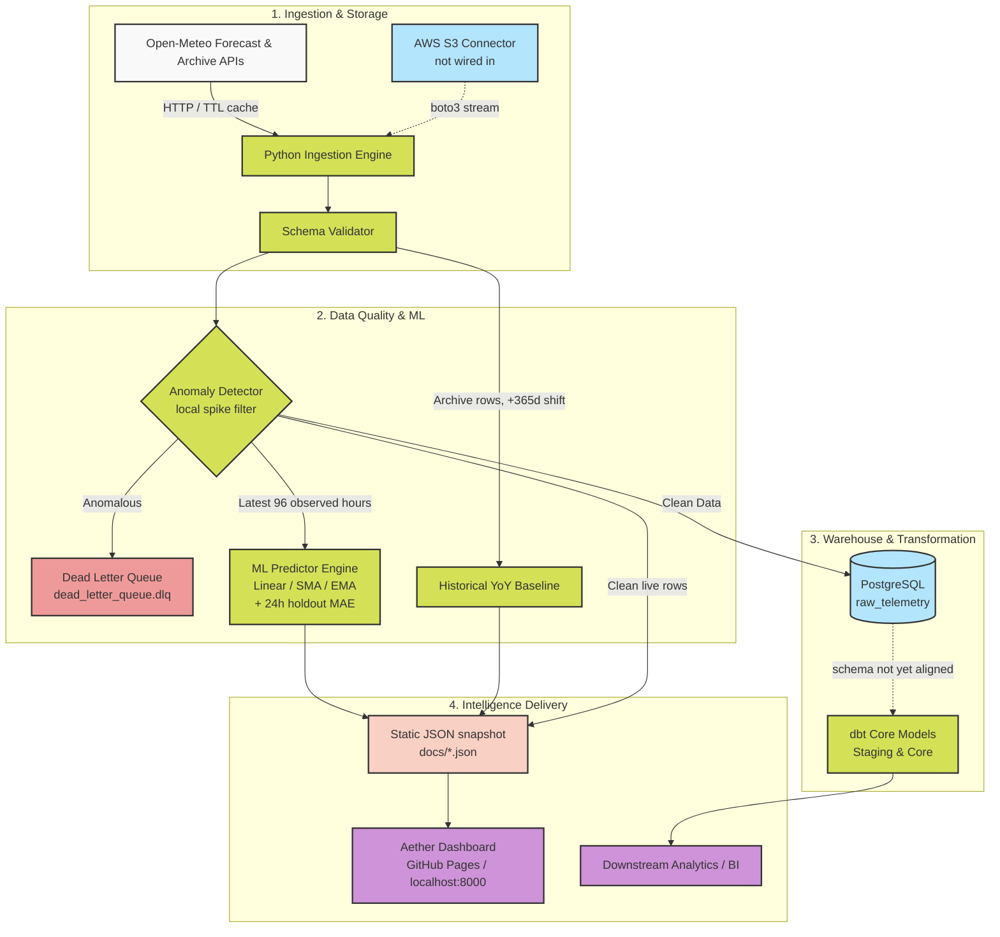

# Aether — Climate Intelligence & Telemetry Analytics Engine

[](https://github.com/miladgk/aether-climate-engine/actions)
[](https://www.python.org/downloads/)
[](https://www.postgresql.org/)
[](https://github.com/psf/black)
[](https://www.getdbt.com/)
[](https://airflow.apache.org/)
[](https://www.terraform.io/)
[](https://opensource.org/licenses/MIT)

**Aether** is an end-to-end weather-telemetry pipeline and dashboard. It pulls hourly temperature and wind data for five cities from the Open-Meteo APIs, validates it, filters statistical outliers into a dead-letter queue, produces 48-hour forecasts with three simple models, and compares everything against the same hours one year earlier in a static Chart.js dashboard published on GitHub Pages.

<div align="center">
  
</div>

**Live dashboard:** [miladgk.github.io/aether-climate-engine](https://miladgk.github.io/aether-climate-engine/)

---

## 🌟 Key Features

- **🌐 Multi-Station Global Ingestion**: Hourly atmospheric data ingestion pipeline supporting global monitoring stations (Berlin, Tokyo, New York, London, Sydney) via the Open-Meteo forecast & archive HTTP APIs, with a local TTL response cache. (An AWS S3 streaming connector exists in `src/infrastructure/s3_connector.py` but is not wired into the current pipeline.)
- **🔍 Statistical Anomaly Detection**: A local spike filter on live temperature and wind (per station): each hour is compared with a robust line fitted through the 3 hours on either side, and flagged only if it is more than 2.0 robust σ *and* more than 2.5 °C (temperature) or 12 km/h (wind) off. Normal daily peaks and gradual weather changes pass; sudden jumps are routed, with schema failures, to a Dead Letter Queue (`dead_letter_queue.dlq`).
- **🤖 Multi-Model Machine Learning Engine**:
  - **Linear Regression**: Diurnal harmonic trend forecasting with graceful pure-Python fallback.
  - **Simple Moving Average (SMA)**: Rolling window baseline trend smoothing.
  - **Exponential Moving Average (EMA)**: Exponential decay memory modeling for high-responsiveness.
- **📈 Full-Timeline YoY Comparative Analytics**: Pulls the same calendar window from one year earlier (Open-Meteo archive API), shifts it forward 365 days, and overlays it on the live and forecast curves.
- **🎛️ Field Research Station Dashboard**:
  - Live animated telemetry plotting with Chart.js.
  - Dynamic unit conversion on the fly ($^\circ\text{C} \leftrightarrow ^\circ\text{F}$, $\text{km/h} \leftrightarrow \text{m/s}$) with auto-scaling delta thresholds.
  - Interactive multi-theme engine (*Ember*, *Nord*, *Stone*).
  - A "NOW" meridian (dashed line, label, and pulsing beacon) marking the boundary between observed data and the forecast.
  - Per-station YoY anomaly badges, with the biggest warming outlier glowing red and the biggest cooling outlier glowing blue.
  - A "Compare All" ensemble view (default) that shades the min/max band across the three models, and a badge that stars the model with the lowest holdout MAE for the selected station. The MAE is computed by the pipeline (each model forecasts the last 24 observed hours from the hours before them) and published in `docs/station_summary.json`.
  - 12h / 24h / 48h forecast horizon switching. The chart always shows twice as many observed hours as forecast hours (96 + 48, 48 + 24, 24 + 12), on a real hourly time axis in the station's local time.
- **🏗️ Data Warehouse & Orchestration**: Clean readings are batch-loaded into a PostgreSQL `raw_telemetry` table (with graceful fallback when the DB is down), and an **Apache Airflow** DAG wraps the daily ingestion. The **dbt Core** project (staging + core models) currently models a separate user-clickstream schema, not the weather data — see **Known Limitations** below.
- **☁️ Infrastructure as Code (IaC)**: **Terraform** configurations for an AWS S3 bucket (with a 30-day Glacier lifecycle rule) and an RDS PostgreSQL 15 instance. Not provisioned against a live AWS account; the DB password has no default and must be supplied via `TF_VAR_db_password`.
- **🧪 Robust Testing & Security**: Unit, smoke, integration (real PostgreSQL), E2E + cross-browser compatibility (Chromium/Firefox/WebKit via Playwright) and regression test layers via Pytest (`pytest-mock`, `moto`), a custom AST security scan (`scripts/custom_bandit.py`; Bandit itself runs as a pre-commit hook), `pip-audit` dependency/CVE scanning, and a GitHub Actions CI workflow that runs them all on every push/PR.

---

## 🏛️ System Architecture



---

## 📁 Repository Structure

```
.
├── .github/workflows/          # ci.yml (tests, scans, dbt checks) & pages.yml (GitHub Pages deploy)
├── config.json                 # Station coordinates, ML horizons & pipeline configuration
├── docker-compose.yml          # Local PostgreSQL 15 + Metabase
├── Makefile                    # Shortcuts: data-pipeline, test, dashboard, up/down, dbt-run …
├── sample_telemetry.json       # 5,000 synthetic clickstream events (not weather data)
├── dags/                       # Apache Airflow workflow DAG definitions
│   └── daily_telemetry_ingestion.py  # Airflow daily ingestion DAG
├── dbt_telemetry/              # dbt Core dimensional models & staging SQL
│   ├── dbt_project.yml
│   └── models/
│       ├── staging/            # Data cleansing & column casting
│       └── core/               # Fact table (fct_user_events)
├── docs/                       # Aether Command Center Web Interface — also the live GitHub Pages site
│   ├── index.html              # Custom Field Station interface & Chart.js engine
│   ├── sample_telemetry.json   # Live & Historical station telemetry cache
│   ├── predictions.json        # Precomputed multi-model ML forecast output
│   ├── station_summary.json    # Per-station time zone & holdout MAE (drives the model ranking)
│   ├── favicon.svg / dashboard_preview.jpg
│   ├── data_dictionary.md      # Schema definitions & metric types
│   └── runbook.md              # Operational runbook & troubleshooting
├── scripts/                    # Utility scripts & dashboard server
│   ├── serve_dashboard.py      # Lightweight local telemetry server
│   ├── custom_bandit.py        # Static security analyzer script
│   ├── generate_mock_data.py   # Synthetic clickstream data generator
│   └── profile_data.py         # Quick data profiling helper
├── src/                        # Core Python package
│   ├── etl/
│   │   ├── anomaly_detector.py # Local spike filter (robust line fit ±3h)
│   │   ├── cache_manager.py    # Local filesystem TTL caching
│   │   ├── extract_load.py     # Main ingestion orchestrator
│   │   ├── utils.py            # PII hashing & JSON flattening
│   │   └── validator.py        # Schema validation
│   ├── infrastructure/
│   │   ├── postgres_connector.py # SQLAlchemy / Psycopg2 batch loader
│   │   └── s3_connector.py     # boto3 S3 streaming connector (not wired into the pipeline)
│   └── ml/
│       └── predictor.py        # Linear, SMA, and EMA forecasting models
├── terraform/                  # Infrastructure as Code
│   ├── main.tf                 # S3 bucket (Glacier lifecycle) & RDS PostgreSQL
│   └── variables.tf            # Inputs; db_password has no default
└── tests/                      # Automated test suite (unit, smoke, integration, E2E)
    ├── conftest.py             # Mock fixtures (AWS, Postgres)
    ├── test_extract_load.py    # Unit: ETL logic
    ├── test_predictor.py       # Unit: ML forecasting models
    ├── test_pii.py             # Unit: PII hashing
    ├── test_anomaly_detector.py  # Unit: spike filter (peaks/fronts kept, faults flagged)
    ├── test_smoke.py           # Smoke: fast end-to-end sanity pass
    ├── test_integration_postgres.py  # Integration: real PostgreSQL round-trip
    └── test_e2e_dashboard.py   # E2E + Compatibility: live dashboard across 3 browser engines
```

---

## 🚀 Quickstart Guide

### 1. Prerequisites
- Python 3.10+
- (Optional) Docker & Docker Compose (for PostgreSQL)

### 2. Clone and Setup Environment
```bash
git clone https://github.com/miladgk/aether-climate-engine.git
cd aether-climate-engine

# Create and activate virtual environment
python3 -m venv venv
source venv/bin/activate

# Install dependencies
pip install -r requirements.txt
```

### 3. Environment Configuration (optional)
The pipeline reads `POSTGRES_HOST`, `POSTGRES_PORT`, `POSTGRES_USER`, `POSTGRES_PASSWORD` and `POSTGRES_DB` from the environment. Nothing loads a `.env` file automatically, and the code defaults already match `docker-compose.yml`, so you can skip this step. If you use `.env.example`, note that its `POSTGRES_USER`/`POSTGRES_DB` values (`postgres` / `telemetry_db`) do **not** match the Compose database (`aether_user` / `aether_warehouse`). Edit them before exporting:
```bash
docker compose up -d postgres   # optional; without it the DB insert is skipped with a warning
```

### 4. Run the ETL & Machine Learning Pipeline
Execute the ingestion script to fetch station data, run anomaly detection, and compute multi-model forecasts. It overwrites `docs/sample_telemetry.json`, `docs/predictions.json` and `docs/station_summary.json`:
```bash
PYTHONPATH=. python3 src/etl/extract_load.py
```

### 5. Launch the Command Center Dashboard
Start the local dashboard server (it re-runs the ETL once on startup, then serves `docs/`):
```bash
python3 scripts/serve_dashboard.py
```
Open **[http://localhost:8000](http://localhost:8000)** in your browser.

---

## 🧪 Testing & Quality Assurance

This project exercises several layers of the testing pyramid, each catching a different class of bug:

| Layer | Files | What it catches |
|---|---|---|
| **Unit** | `test_extract_load.py`, `test_predictor.py`, `test_pii.py`, `test_anomaly_detector.py` | Logic bugs in a single function (JSON flattening, mocked Open-Meteo ingestion, observed-window/local-time handling, DB graceful fallback, trend/amplitude math, holdout MAE, spike filter, PII hashing), fully mocked — no network, no DB. |
| **Smoke** | `test_smoke.py` | Fast, shallow sanity pass over the whole build: do core modules import, is `config.json` valid, do the ETL/ML stages run end-to-end on a tiny dataset? |
| **Integration** | `test_integration_postgres.py` | `PostgresClient` against a **real** PostgreSQL instance (table creation, bulk insert via `execute_values`, round-tripped reads) — the SQL path that mocks can't verify. Auto-skips if no database is reachable. |
| **E2E** | `test_e2e_dashboard.py` | Drives the actual dashboard with Playwright: page loads, Chart.js renders both charts, unit/theme toggles update the UI, station switching updates the topbar — the only layer that touches the frontend JS at all. |
| **Compatibility** | `test_e2e_dashboard.py` (parametrized) | Every E2E test above runs once per rendering engine — **Chromium, Firefox, WebKit/Safari** — so a browser-specific CSS/JS quirk fails on that one engine instead of going unnoticed. Any engine not installed is skipped individually. |
| **Regression** | the full suite, run in CI on every push/PR | Re-runs everything above automatically so a change can't silently break a previously-working feature. |
| **Security (SAST)** | `scripts/custom_bandit.py` | Static scan for insecure patterns in *our own code* (hardcoded secrets, unsafe deserialization, etc.). |
| **Dependency / SCA Scanning** | `pip-audit` (CI step) | Scans every *third-party* package actually installed (`apache-airflow`, `protobuf`, `pytest`, etc.) against the PyPA Advisory Database for known CVEs — catches vulnerable dependencies that SAST never looks at. Advisory only: reports findings in the CI log without failing the build, since upgrading a pinned framework version (e.g. Airflow) is a deliberate decision, not something a gate should force on every push. |

Run everything:
```bash
# Full suite (unit + smoke + integration where a DB is reachable + E2E where a browser is installed)
# Always pass tests/: a bare `pytest` also collects the vendored bandit/ checkout and errors out.
pytest tests/ -v

# Just the integration tests, against a local Postgres container:
docker run -d -p 5432:5432 \
  -e POSTGRES_USER=aether_user -e POSTGRES_PASSWORD=aether_password \
  -e POSTGRES_DB=aether_warehouse postgres:15
pytest tests/test_integration_postgres.py -v

# Just the E2E + cross-browser compatibility tests (one-time browser install, then run):
playwright install chromium firefox webkit
pytest tests/test_e2e_dashboard.py -v

# Run security static analysis (our own code)
python3 scripts/custom_bandit.py

# Scan third-party dependencies for known CVEs
pip install pip-audit
pip-audit
```

The CI workflow (`.github/workflows/ci.yml`) spins up a real Postgres service container, so the integration tests run on every push/PR, not just locally.

### Dependency remediation (what `pip-audit` found and what we did about it)

Running the scan surfaced a real, pre-existing dependency conflict and a set of outdated/vulnerable pins. Here's what was fixed and what's structurally blocked:

**Fixed:**
- Removed an explicit `protobuf<4.25.0` pin that conflicted with `apache-airflow`'s own `opentelemetry-proto` requirement (`protobuf>=5.0`) — this was breaking `pip install -r requirements.txt` entirely on a clean environment.
- `dbt-core`/`dbt-postgres` `1.7.0` → `1.7.20` (a patch release on the same stable branch, not the breaking 1.8 package-split). Removing the protobuf pin above initially let pip resolve a protobuf version that satisfied everyone's *declared* version ranges but still crashed dbt-core 1.7.0 at runtime — its event-serialization code calls a protobuf `MessageToJson(..., including_default_value_fields=...)` API that newer protobuf releases removed, a bug the old tight pin had been silently working around. This is exactly what broke `dbt debug` in CI with `TypeError: MessageToJson() got an unexpected keyword argument`. `1.7.20` fixed that call internally, so `pip`'s resolver now lands on `protobuf==4.25.9` and both `dbt debug`/`dbt deps` exit cleanly. As a bonus, `1.7.20` also relaxed dbt-core's own `sqlparse` pin, which cleared the `sqlparse` CVEs for free.
- `apache-airflow` `2.8.1` → `2.10.5` (latest 2.x release) — removes every CVE that had a 2.x fix, without the breaking API migration to Airflow 3.x. Updated `dags/daily_telemetry_ingestion.py` to drop two now-deprecated APIs (`schedule_interval` → `schedule`, removed `provide_context=True`) surfaced by the upgrade.
- `pytest` `8.0.0` → `9.0.3` — verified against the full suite (30 tests, including E2E across 3 browsers and the Postgres integration tests) on Python 3.10, matching CI exactly.
- `pip`/`setuptools` are now upgraded explicitly in the CI install step.
- CI runner pinned to `ubuntu-24.04` instead of the floating `ubuntu-latest`, after GitHub moved "latest" to a newer Ubuntu release whose package names (`libicu74`, `libxml2`, etc.) aren't yet recognized by Playwright's `--with-deps` installer.

**Structurally blocked (verified by actually attempting each, not guessed):**
- `apache-airflow` and its provider packages still carry CVEs whose only fix is Airflow **3.x** — a breaking architecture change, out of scope for an in-place dependency bump.
- `cryptography`, `urllib3` can't be upgraded past their vulnerable versions because `dbt-core` (even at `1.7.20`) still hard-pins `cffi<2.0.0` and `urllib3~=1.0`; every patched release of those two libraries requires newer versions than that. Unblocking this needs a `dbt-core` 1.8+ upgrade (a package-split architecture change in dbt itself) that hasn't been validated against this project's `dbt_telemetry/` models.
- `flask`, `werkzeug`, `flask-appbuilder` are version-capped by Airflow 2.x's own webserver compatibility requirements, not by anything in this project.
- `dnspython`, `filelock` only ship CVE fixes in releases that require **Python 3.11+**, while CI runs Python 3.10.

Every fix above was verified end-to-end on Python 3.10 in a disposable environment (clean `pip install`, `dbt debug`/`dbt deps`, and the full pytest suite including Postgres integration and 3-browser E2E) before being pushed — not assumed from reading changelogs. The dependency scan step stays advisory (reports, doesn't fail the build) so the remaining, upstream-blocked findings don't turn CI red on every push.

---

## 📊 dbt Dimensional Modeling

> **Note:** the dbt models currently describe a user-clickstream schema (`event_id`, `user_id`, …), not the weather columns the ETL writes to `raw_telemetry`. `dbt debug`/`dbt deps` run in CI, but `dbt run` against weather data will fail until the models are rewritten.

To compile and execute the dbt transformation models:
```bash
cd dbt_telemetry
dbt deps
dbt run
dbt test
dbt docs generate && dbt docs serve
```

---

## ⚠️ Known Limitations

- **dbt ↔ pipeline mismatch:** the dbt models and `docs/data_dictionary.md` describe clickstream events, not weather telemetry.
- **S3 connector unused:** ingestion goes straight to Open-Meteo over HTTP; `s3_connector.py` is legacy code.
- **Static live site:** the GitHub Pages dashboard serves precomputed JSON snapshots and shifts their timestamps to the viewer's current hour in the browser; it does not run the Python ETL/ML on each visit.
- **No cloud deployment:** the Terraform config has not been applied to a live AWS account.
- **Leap years:** the YoY baseline uses a fixed 365-day offset.
- **Secrets scanning scope:** `scripts/custom_bandit.py` only scans Python in `src/`; Terraform, YAML, and Docker Compose files are not scanned for hardcoded secrets.
- **"Observed" means Open-Meteo's past-hours data:** observed hours come from the forecast API's `past_days` output (Open-Meteo's best-estimate weather for hours that have already happened), not raw readings from a physical station.
- **Single UTC offset per station:** each station's current UTC offset (from Open-Meteo) is used to place "now". A daylight-saving change inside the window can shift the NOW line by an hour.
- **Anomaly filter scope:** only live rows are filtered (historical rows are not). The spike filter can occasionally drop the hour right at a very abrupt real change, and it can't tell a wind drop to near-calm from a real calm hour unless the drop is large.
- **PII hashing not applied:** `_hash_pii` (`src/etl/utils.py`) is imported by the ETL but never called. It is written for the synthetic clickstream shape, which has PII; the weather data has none.
- **No working backfill:** the `--date` / Airflow `ds` argument is only logged. Every run fetches the current window.
- **Dev tooling not in `requirements.txt`:** `make setup` (`pre-commit`) and `make lint` (`bandit`, `ruff`, `sqlfluff`) need those tools installed separately, and `scripts/profile_data.py` needs `ydata-profiling`.

---

## 📄 License

This project is licensed under the MIT License — see the [LICENSE](LICENSE) file for details.
